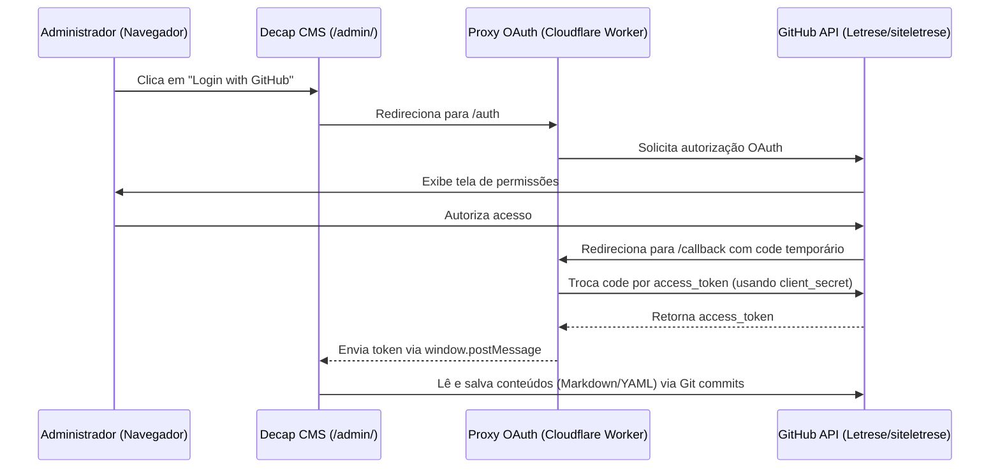

# Guia de Administração e Configuração de Autenticação OAuth (Decap CMS)

Este documento fornece as instruções passo a passo para gerenciar o conteúdo do portal do grupo de pesquisa **Letrese** através do **Decap CMS v3.x**, bem como a configuração do proxy de autenticação GitHub OAuth no **GitHub Pages**.

---

## 1. Visão Geral da Arquitetura

O Decap CMS opera como uma Single Page Application (SPA) acessível na rota `/admin/`. Ele se comunica diretamente com a API do GitHub através de commits na branch `main`:



---

## 2. Opção A: Teste Local Imediato (Sem Configurar OAuth)

Para testar ou alimentar o site na sua máquina local sem precisar criar um aplicativo OAuth no GitHub:

1. No arquivo `admin/config.yml`, descomente ou adicione a linha:
   ```yaml
   local_backend: true
   ```
2. No terminal da pasta `siteletrese`, inicie o servidor proxy local do Decap:
   ```powershell
   npx decap-server
   ```
3. Abra `http://localhost:8080/admin/` (ou a porta onde seu site estiver sendo servido). O Decap CMS lerá e salvará os arquivos diretamente no disco local!

---

## 3. Opção B: Configuração para Produção no GitHub Pages (Cloudflare Worker Gratuito)

Para que a equipe edite o site diretamente na nuvem (GitHub Pages):

### Passo 1: Criar o GitHub OAuth App
1. Acesse o GitHub: **Settings > Developer Settings > OAuth Apps > New OAuth App** (ou [link direto](https://github.com/settings/applications/new)).
2. Preencha os campos:
   - **Application name:** `Letrese Portal CMS`
   - **Homepage URL:** `https://letrese.github.io/siteletrese/`
   - **Authorization callback URL:** `https://letrese-oauth-proxy.<seu-subdominio>.workers.dev/callback` (coloque a URL que seu Cloudflare Worker receberá no passo seguinte).
3. Clique em **Register application**.
4. Copie o **Client ID**.
5. Clique em **Generate a new client secret** e copie o **Client Secret**.

### Passo 2: Publicar o Cloudflare Worker (Gratuito)
1. Crie uma conta gratuita em [Cloudflare.com](https://dash.cloudflare.com/) se ainda não tiver.
2. No menu lateral, acesse **Workers & Pages > Create application > Create Worker**.
3. Dê o nome de `letrese-oauth-proxy` e clique em **Deploy**.
4. Clique em **Edit code** e cole o conteúdo do arquivo `auth-proxy/worker.js`.
5. Vá em **Settings > Variables and Secrets**:
   - Adicione `GITHUB_CLIENT_ID` com o valor copiado do GitHub.
   - Adicione `GITHUB_CLIENT_SECRET` (como Secret criptografado) com o valor copiado do GitHub.
6. Copie a URL pública do seu Worker (ex: `https://letrese-oauth-proxy.<seu-subdominio>.workers.dev`).
7. Se necessário, volte nas configurações do GitHub OAuth App e confirme que a **Authorization callback URL** está exatamente como `https://sua-url-worker/callback`.

### Passo 3: Atualizar o `admin/config.yml`
No arquivo `admin/config.yml`, ative os campos `base_url` e `auth_endpoint`:

```yaml
backend:
  name: github
  repo: Letrese/siteletrese
  branch: main
  base_url: https://letrese-oauth-proxy.seu-subdominio.workers.dev
  auth_endpoint: auth
```

Faça commit e envie para o GitHub (`git push`). Pronto! Ao acessar `https://letrese.github.io/siteletrese/admin/`, qualquer membro com acesso de escrita ao repositório poderá fazer login com o GitHub e criar/editar notícias, membros, projetos e informações institucionais.

---

## 4. O que pode ser gerenciado no painel?

- **Descritor e Dados do Grupo:** Nome completo, descrição institucional, missão, visão, valores, linhas de pesquisa e dados de contato.
- **Membros e Participantes:** Cadastro de pesquisadores, docentes, discentes, cargos, titulação, links para Lattes e ORCID, foto e biografia detalhada.
- **Projetos de Pesquisa:** Cadastro de projetos em andamento e concluídos, coordenadores, agências de fomento (CNPq, CAPES, etc.), resumos e texto completo.
- **Notícias e Publicações:** Criação de informes, lançamentos de artigos, editais e eventos com tags e categorização.
